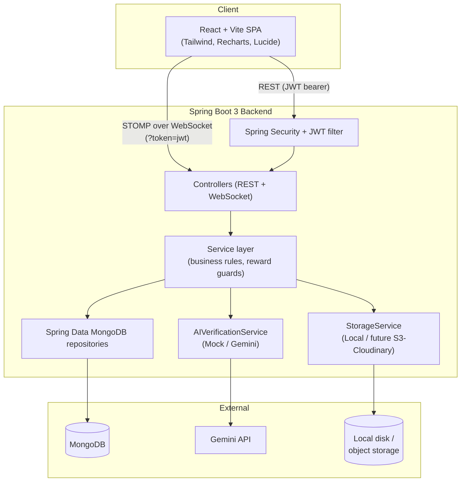

# Architecture

## System overview



## Layering

Every feature follows the same path: **Controller → Service → Repository → MongoDB**. Controllers hold no business logic — they translate HTTP/DTOs to service calls. Services hold every business rule (reward-once guards, school scoping, badge criteria, streak math). Repositories are thin Spring Data interfaces.

```
com.ecoquest
├── controller/     REST endpoints, role-scoped by URL prefix (/api/student, /api/teacher, /api/admin)
├── service/        All business logic
├── repository/     Spring Data MongoDB interfaces
├── entity/         MongoDB documents (+ entity/embedded, entity/enums)
├── dto/            Request/response shapes - entities are never returned directly
├── mapper/         Entity <-> DTO conversion helpers
├── security/       JWT generation/validation, Spring Security wiring
├── exception/      ApiException + GlobalExceptionHandler (consistent error shape)
├── config/         Spring @Configuration classes (security, CORS, AI provider, WebSocket, uploads)
├── ai/             AIVerificationService interface + Mock/Gemini implementations
├── storage/        StorageService interface + local-disk implementation
├── websocket/       JWT-authenticated STOMP handshake handling
├── util/           Stateless helpers (GeoUtils, MapUrlUtil, LevelUtil)
└── seed/           DataSeeder (demo data, gated behind SEED_DATA=true)
```

## Why MongoDB instead of a relational schema

The project was built on **MongoDB + Spring Data MongoDB**, not MySQL/JPA, by explicit choice partway through development. A few entities are deliberately **embedded** rather than split into their own collection, because they're always read/written together with their parent and splitting them would only add round-trips with no benefit:

- `Student`/`Teacher` profiles live embedded inside `User` (one document per person, selected by `role`) rather than as separate collections.
- `VerificationResult` (AI output) is embedded inside `QuestSubmission` — always shown together on the teacher review screen.
- `Streak` is embedded inside a student's profile — just a counter and a date, not worth its own collection.
- `GeoLocation` is a small reusable value object embedded wherever coordinates are needed.

Everything else — `School`, `EvsTopic`, `Lesson`, `Quiz` (with embedded `Question`s), `QuizAttempt`, `Quest`, `QuestSubmission`, `EcoCoinTransaction`, `Badge`, `StudentBadge`, `Notification`, `ImpactMetric`, `ImpactFormulaConfig` — is its own collection, managed independently. See `docs/database.md` for the full collection reference.

## Reward integrity (the part worth understanding before extending this code)

Eco-Coins are never a bare editable number. `EcoCoinTransaction` is an append-only ledger; `User.studentProfile.ecoCoins` is a cached sum kept in sync **only** by `EcoCoinService.award(...)` — no other code path is allowed to touch that field. Every reward-granting action (quiz first-attempt, quest approval, badge unlock, streak milestone) goes through that one method, which is also where the "only reward once" guards live (`QuizAttempt.rewarded`, `QuestSubmission.rewardGranted`).

## Real-time updates

`SubmissionReviewService.approve` and `QuizService.submitAttempt` both capture the student's rank *before* awarding a reward, then call `RealtimeLeaderboardService.notifyIfRankChanged`, which pushes a STOMP message to `/user/{studentId}/queue/leaderboard` if the rank actually moved. The WebSocket handshake is authenticated via a JWT passed as a query param (`/ws?token=...`), since the browser's WebSocket client can't set an `Authorization` header on the handshake request.

## AI verification is advisory, never authoritative

`AIVerificationService` (mock by default, real Gemini vision call if `AI_PROVIDER=gemini`) only ever changes a submission's status from `PENDING` to `AI_REVIEWED` and populates the embedded `VerificationResult`. It never sets `APPROVED`/`REJECTED` and never calls `EcoCoinService`. Only a teacher (or an admin override) can do that, in `SubmissionReviewService`.
