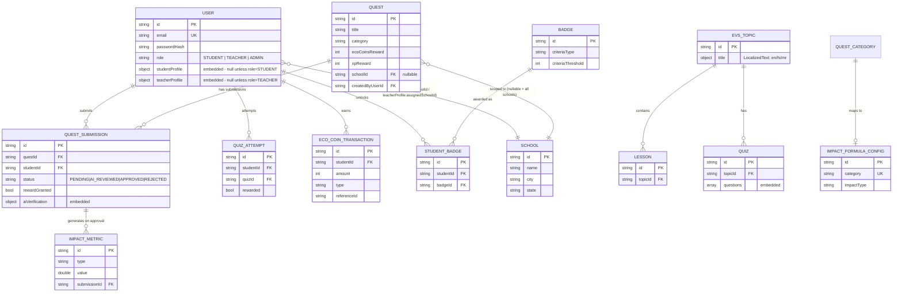

# Database Reference (MongoDB)

## Relationship diagram

References are by string id (Mongo doesn't enforce foreign keys) — the diagram below shows the logical relationships.

## Collections

| Collection | Purpose | Key indexes |
|---|---|---|
| `users` | Every person — role-specific data embedded (`studentProfile`/`teacherProfile`) | unique `email` |
| `schools` | School directory | — |
| `evs_topics` | Learning topics, localized (`title`/`description` as `{en,hi,mr}`) | — |
| `lessons` | Bite-sized content units under a topic | `topicId` |
| `quizzes` | Quiz + embedded `questions[]` (never sent to the client with `correctOptionIndex` before grading) | `topicId` |
| `quiz_attempts` | One row per attempt; `rewarded` guards against repeat-reward abuse | compound `(studentId, quizId)` |
| `quests` | Eco-challenge definitions, including geofence config | `createdByUserId` |
| `quest_submissions` | Evidence + AI result (embedded) + review outcome; `rewardGranted` is the once-only guard | `questId`, `studentId`, `status`, compound `(studentId, questId)` |
| `eco_coin_transactions` | **Source of truth** for all coin balances — append-only ledger | `studentId`, `referenceId` |
| `badges` | Badge definitions and unlock criteria | unique `code` |
| `student_badges` | Which student earned which badge, and when | unique compound `(studentId, badgeId)` |
| `leaderboard_snapshots` | Reserved for a future caching layer — leaderboards are currently computed live | — |
| `notifications` | Reserved — notification creation isn't wired into any flow yet | `userId` |
| `impact_metrics` | One row per approved submission's estimated environmental contribution | `studentId`, `submissionId` |
| `impact_formula_configs` | Admin overrides for the category→impact-metric formulas (falls back to hardcoded defaults) | unique `category` |

## Why cached balances instead of always summing the ledger

`User.studentProfile.ecoCoins`/`xp` are denormalized caches, updated atomically (`$inc`) by `EcoCoinService.award(...)` at the same time a ledger entry is appended. This keeps dashboard/leaderboard reads fast (no aggregation needed for the common case) while `eco_coin_transactions` remains the audit trail and the thing admin adjustments and weekly/monthly leaderboard windows actually compute from.
